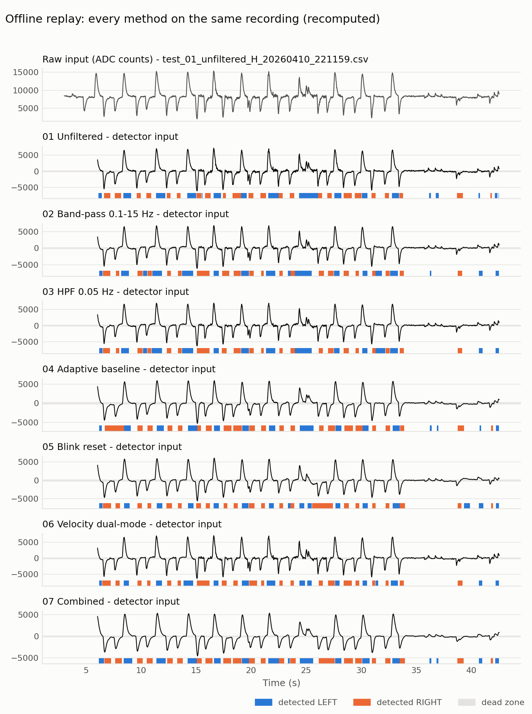
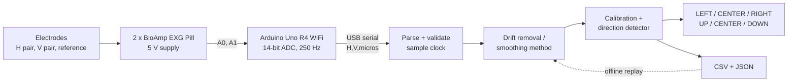

# EOG eye-movement direction detection: drift-removal methods compared

A two-channel electrooculography (EOG) system built for an MEng Biomedical Engineering
project. Two BioAmp EXG Pill front ends feed the 14-bit ADC of an Arduino Uno R4 WiFi,
which streams samples over USB serial to a Python pipeline that removes baseline drift,
smooths the signal and classifies gaze direction (left / centre / right, up / centre /
down). The project compares seven processing methods - an unfiltered baseline, two fixed
filters from the literature and four of the author's own - on six recorded sessions. This
repository contains the firmware, a tested Python package with one implementation of every
method, the recorded data, and an offline replay tool that re-runs any method on any
recording so the whole comparison can be reproduced without hardware.

## Key results

Every figure below can be traced to a file in this repository. "Recorded" means taken from
the original run files in `data/recorded`. "Replay" means computed by offline replay of the
raw signal in those files with this package; all method-comparison numbers, including
everything reported for Test 07, are replay results.

- **Like-for-like comparison by replay (`docs/results/replay_comparison_summary.csv`).**
  The original design used a different 30 s recording for each method. Replaying all seven
  methods over the same 42 recordings shows they are closer than separate recordings
  suggested: direction-change counts overlap within one standard deviation for every method
  and centre fractions mostly do (Test 05 on the horizontal channel is the exception). The
  consistent difference is noise: the author's methods give a detector input with a
  peak-to-noise ratio of 30-35 dB, against 25-28 dB unfiltered and 28-31 dB for the
  literature filters. The combined system (Test 07) has the highest mean on both channels
  (34.8 dB horizontal, 32.6 dB vertical), within one standard deviation of Tests 04 and 05.
- **Negative result - blink-locked baseline reset (Test 05) does not work on this front
  end.** The recorded Test 05 runs count 17-27 "blinks" in 30 s (`Blink_Count` in
  `data/recorded/*/test_05_*.csv`): the amplitude-and-duration rule cannot tell a blink from
  the transient every saccade produces. Replay adds a second finding
  (`docs/results/timing_sensitivity.csv`): 0-1 ms of timestamp jitter changes its direction
  output on up to 27 % of samples, against at most 2 % for the other methods. The method
  was therefore left out of the combined system.
- **The package reproduces the original recordings (`docs/results/replay_verification.csv`).**
  Re-processing each recorded file with the method that produced it gives the recorded
  output exactly, to the two decimals stored, for Tests 01-03 (100 % of direction labels),
  and with an RMS error of 0.14 % / 0.75 % of the signal SD for Tests 04 / 06 (99.97 % /
  99.66 % of labels). Test 05 and the historical April variant agree on 94 % / 89 % of
  labels, limited by the timing sensitivity above. All 84 fields of the recorded JSON
  summaries recompute from their CSVs to within 0.01.

Computed by offline replay on the recorded sessions (mean ± SD over 21 recordings per
channel, identical input for every method):

| Method | Peak-to-noise dB, H | Peak-to-noise dB, V | Direction changes, H | Direction changes, V |
|---|---|---|---|---|
| 01 Unfiltered | 27.7 ± 1.9 | 25.3 ± 2.6 | 29.0 ± 6.3 | 29.6 ± 3.3 |
| 02 Band-pass 0.1-15 Hz [3] | 30.7 ± 1.8 | 28.1 ± 2.5 | 26.9 ± 5.9 | 25.8 ± 3.9 |
| 03 High-pass 0.05 Hz [15] | 30.3 ± 1.8 | 27.6 ± 2.5 | 26.6 ± 5.7 | 25.4 ± 4.2 |
| 04 Adaptive baseline | 34.2 ± 1.9 | 31.7 ± 2.0 | 28.4 ± 5.6 | 26.5 ± 3.0 |
| 05 Blink reset | 34.2 ± 2.0 | 32.1 ± 2.0 | 27.7 ± 5.7 | 26.8 ± 2.7 |
| 06 Velocity dual-mode | 31.7 ± 3.1 | 29.7 ± 2.3 | 28.1 ± 5.8 | 26.2 ± 3.7 |
| **07 Combined (04 + 06)** | **34.8 ± 2.1** | **32.6 ± 1.9** | 29.3 ± 5.6 | 28.1 ± 2.4 |

Peak-to-noise is a label-free proxy defined in `eog/metrics.py`, not a detection accuracy.
The recordings have no documented cue protocol, so direction accuracy cannot be computed
from them and none is claimed anywhere in this repository. See [Limitations](#limitations).



## Signal chain



Details: [docs/signal-chain.md](docs/signal-chain.md).

## Methods compared

| Test | Method | Origin | Outcome |
|---|---|---|---|
| 01 | Unfiltered, fixed calibration baseline | baseline | Reference for the others |
| 02 | Fixed band-pass 0.1-15 Hz (first-order sections) | Hossain [3] | Works; first-order sections (originally labelled "Butterworth"), realised low-pass corner 9.4 Hz |
| 03 | High-pass 0.05 Hz (two cascaded first-order sections) + 20 Hz low-pass | Soltani [15], [9] | Works; critically damped rather than Butterworth |
| 04 | Adaptive EMA baseline with velocity gate | novel | Lowest-noise detector input alongside 05 and 07 |
| 05 | Blink-locked baseline reset | novel | **Negative result**: the blink detector fires on saccades and is timing-sensitive; excluded from the combined system |
| 06 | Velocity-domain dual-mode smoothing | novel | Works; heavy smoothing in fixation, light during saccades (coefficient assignment corrected from the original scripts) |
| 07 | Combined system (04 + 06) | novel | Highest mean peak-to-noise on both channels (within one SD of 04 and 05); results computed by offline replay on the recorded sessions |

Historical note: the recorded `test_07_full_*` files come from an earlier April "full
system" (Tests 04 + 05 + 06, i.e. still including the blink reset). They are kept unmodified
and used to verify the replay code, but they are not Test 07 as presented here.

Equations and parameters: [docs/methods.md](docs/methods.md). What was checked, renamed,
fixed and left alone, and why: [docs/methods-review.md](docs/methods-review.md).

## Hardware

| Item | Detail |
|---|---|
| Microcontroller | Arduino Uno R4 WiFi (Renesas RA4M1), 14-bit ADC on the default 5 V reference (nominal, not measured) |
| Front end | 2 x BioAmp EXG Pill, powered from 5 V. Gain: not yet confirmed |
| Scale | Nominally 0.305 mV per ADC count at the ADC pin. Electrode-referred microvolts cannot be stated until the gain is confirmed |
| Electrodes | `<type>`; horizontal pair at the outer canthi, vertical pair above and below the right eye, reference on the mastoid |
| Link | USB serial, 115200 baud |

Wiring (from the firmware):

| EXG Pill | Arduino |
|---|---|
| Horizontal OUT | A0 |
| Vertical OUT | A1 |
| VCC (both) | 5V |
| GND (both) | GND |

`<Add a wiring photo or diagram.>`

## Quick start

Python 3.9+ (developed and tested on 3.13). Run everything from the repository root.

```bash
pip install -r requirements.txt     # pyserial; matplotlib and pygame are optional
```

**Run the tests** (standard library `unittest`, no hardware):

```bash
python -m unittest discover -s tests -t .
```

**Offline replay** (no hardware):

```bash
# one method over one recording -> CSV + JSON in analysis_output/replay/
python -m eog replay --input data/recorded/Results_2_Horizontal/test_01_unfiltered_H_20260410_224000.csv --method combined

# all seven methods over the same recordings (add --include-variants for the alternatives)
python -m eog compare --input data/recorded

# check that the package reproduces the recorded outputs
python -m eog verify --data data/recorded
```

**Analysis of the recorded runs:**

```bash
python analysis/eog_analysis.py --data data/recorded --figures
python analysis/timing_sensitivity.py --data data/recorded
```

**Flash the firmware** (see [firmware/README.md](firmware/README.md)):

```bash
pio run -d firmware -t upload       # or open firmware/eog_acquisition in the Arduino IDE
```

**Live test** (needs the hardware):

```bash
python -m eog methods
python -m eog live --method combined --channel H --port COM5      # 30 s after calibration
python -m eog live --method 04 --channel BOTH --duration 0        # until Ctrl+C
python -m eog live                                                # interactive prompts
python tools/visualizer_ball.py --axis both                       # ball follows gaze
```

`live` writes `results/test_<NN>_<tag>_<CH>_<timestamp>.csv` and a `.summary.json` per
channel. Useful options: `--fs`, `--clock firmware|samples|host`, `--original-smoothing`
(as-recorded Tests 06/07), `--butterworth`, `--no-rate-compensation`, `--gain`
(see `python -m eog live --help`).

## Repository layout

```
firmware/
  eog_acquisition/        canonical firmware (v3: 250 Hz, firmware timestamps)
  archive/                v1 (50 Hz, used for the recorded data) and v2
  platformio.ini
eog/                      Python package
  filters.py              the seven methods, one implementation each, no I/O
  detector.py             direction detector and calibrator
  methods.py              method registry (parameters and detector settings per test)
  pipeline.py             sample -> filter -> calibration -> detector -> row + summary
  metrics.py              metric definitions (legacy names mapped, new metrics added)
  units.py                ADC counts -> volts / microvolts
  io.py                   serial parsing, sample clocks, CSV reading and writing
  replay.py               replay, like-for-like comparison, verification
  cli.py                  python -m eog live | replay | compare | verify | methods
analysis/
  eog_analysis.py         aggregate tables and figures from recorded runs
  timing_sensitivity.py   jitter-robustness experiment
tools/visualizer_ball.py  pygame gaze visualiser
data/recorded/            six recorded sessions (42 CSV, 12 JSON), with data/README.md
docs/                     methods, signal chain, data formats, methods review, results, figures
tests/                    unit tests
```

## Limitations

- **No ground truth.** The look sequence used in the recordings was not documented and no
  cue was logged, so direction-detection accuracy cannot be computed. All comparisons use
  label-free quantities.
- **Test 07 has no live recording.** Its results come from replaying the combined system
  over the raw data of the recorded sessions.
- **Small data set.** Six sessions of about 30 s per test, recorded on one evening.
  `<state the number of participants>`.
- **The recorded signal is effectively AC-coupled.** Gaze shifts appear as transients that
  decay within about half a second, so the recordings contain little slow drift for a
  drift-removal method to act on, and the level detector responds to gaze *changes*.
- **All recordings are 50 Hz, made with the v1 firmware.** The canonical 250 Hz firmware
  and the rate-compensation code are covered by unit tests and a successful build, not by
  recorded data.
- **Amplitudes are ADC counts.** The 0.305 mV per count figure at the ADC pin is nominal
  (5 V reference, not measured); microvolts at the electrodes cannot be stated until the
  EXG Pill gain is confirmed.
- **The original metric names overstated what was measured** ("drift µV/min", "stability
  %", "SNR"). They are renamed in code and outputs; the recorded files are untouched. See
  the [methods review](docs/methods-review.md).
- **The saccade/fixation classifier labels roughly two-thirds to three-quarters of samples
  SACCADE**, so the dual-mode stage of Tests 06/07 operates mostly in one mode; correcting
  its smoothing coefficients did not change the replay metrics beyond their spread
  (methods review, section 4.4).

## Future work

1. Cued recording protocol - timed on-screen targets with logged cue times - then accuracy,
   latency and confusion matrices per method (`eog.metrics.direction_accuracy` is ready).
2. Record raw data once per session and evaluate all methods by replay.
3. Confirm the EXG Pill gain and pass band; decide between drift removal on a DC-coupled
   signal and pulse classification on the AC-coupled one.
4. Re-tune at 250 Hz with firmware timestamps, add a mains notch, and derive velocity
   thresholds from measured noise.
5. More participants and sessions.

## Author

Lord Monasterial - MEng Biomedical Engineering individual project, 2026.

## Licence

MIT - see [LICENSE](LICENSE).

## References

Bracketed numbers match the citation numbers used in the code and the project report.

1. L. Tao et al., "Review of electrooculography-based human-computer interaction: recent technologies, challenges and future trends," *Connected Health and Telemedicine*, vol. 2, art. 2000010, 2023.
2. T. Stula et al., "A MATLAB-based GUI for remote electrooculography visual examination," *Lekar a technika*, vol. 50, no. 1, pp. 1–8, 2020.
3. Z. Hossain, M. M. H. Shuvo, and P. Sarker, "Hardware and software implementation of real time electrooculogram (EOG) acquisition system to control computer cursor with eyeball movement," in *Proc. 4th Int. Conf. Adv. Elect. Eng. (ICAEE)*, 2017, pp. 1–6.
4. F. H. F. Botelho, "Accessibility to digital technology: virtual barriers, real opportunities," *Assistive Technology*, vol. 33, no. 1, pp. 27–34, Dec. 2021.
5. M. Merino et al., "A method of EOG signal processing to detect the direction of eye movements," in *Proc. IEEE Xplore*, Jul. 2010.
6. C. Belkhiria et al., "EOG-based human-computer interface: 2000–2020 review," *Sensors*, vol. 22, no. 13, p. 4914, Jan. 2022.
7. A. Lopez et al., "A study on electrode placement in EOG systems for medical applications," in *Proc. IEEE Int. Symp. Med. Meas. Appl. (MeMeA)*, May 2016.
8. C.-S. Hwang et al., "An eye-tracking assistive device improves the quality of life for ALS patients and reduces the caregivers' burden," *J. Motor Behavior*, vol. 46, no. 4, pp. 233–238, Apr. 2014.
9. A. Banerjee et al., "Classifying electrooculogram to detect directional eye movements," *Procedia Technology*, vol. 10, pp. 67–75, 2013.
10. M. Abdullah et al., "A review for filtering techniques of the electrooculography (EOG) signals," *Global J. Eng. Tech. Advances*, vol. 16, no. 3, pp. 163–171, Sep. 2023.
11. S. Aungsakun, "Development of robust electrooculography (EOG)-based human-computer interface controlled by eight-directional eye movements," *Int. J. Physical Sciences*, vol. 7, no. 14, Mar. 2012.
12. S. Nohemy et al., "EOG signal classification with wavelet and supervised learning algorithms KNN, SVM and DT," *Sensors*, vol. 23, no. 9, pp. 4553–4553, May 2023.
13. A. Makalesi et al., "EOG-based computer control system for people with mobility limitations," *European J. Sci. Tech.*, vol. 26, no. 26, pp. 256–261, 2021.
14. L. Y. Deng et al., "EOG-based human-computer interface system development," *Expert Syst. Appl.*, vol. 37, no. 4, pp. 3337–3343, 2010.
15. S. Soltani and A. Mahnam, "A practical efficient human computer interface based on saccadic eye movements for people with disabilities," *Comput. Biol. Med.*, vol. 72, pp. 66–77, 2016.
16. M. Talukder et al., "EOG based home automation system by cursor movement using a graphical user interface (GUI)," in *Proc. IEEE Int. Conf. Inf. Electron. Vis. (ICIEV)*, 2018, pp. 1–6.
17. Texas Instruments, "TL074H low-noise JFET-input quad operational amplifier," datasheet SLOS080.
18. Upside Down Labs, "BioAmp EXG Pill v1.0b," open-source hardware, CERN-OHL-S-2.0, 2024.
19. Arduino, "Arduino UNO R4 WiFi," product documentation, 2023.
20. P. Berg and M. B. Davies, "Eyeblink-related potentials," *Electroencephalography and Clinical Neurophysiology*, vol. 69, no. 1, pp. 1–5, 1988.
21. International Organization for Standardization, "Ergonomic requirements for office work with visual display terminals (VDTs) — Part 9: Requirements for non-keyboard input devices," ISO 9241-9:2000, Geneva, 2000.
22. I. S. MacKenzie, "Fitts' law as a research and design tool in human-computer interaction," *Human-Computer Interaction*, vol. 7, no. 1, pp. 91–139, 1992.
