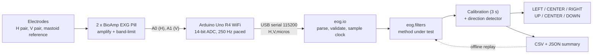

# Signal chain

| Stage | What it does | Known / unknown |
|---|---|---|
| Electrodes | Horizontal pair at the outer canthi, vertical pair above/below the right eye, reference on the mastoid (v1 firmware comment) | Electrode type and skin preparation: `<to be added>` |
| EXG Pill x2 | Powered from the Arduino 5 V pin. Differential amplification and analogue band-limiting; output biased near mid-supply (recordings rest at about 8200 of 16383 counts, i.e. about 2.5 V) | Gain is unconfirmed; pass band not characterised. The recordings behave as AC-coupled (transients decay in about 0.5 s). |
| ADC | `analogReadResolution(14)`, default 5 V reference; H then V read back-to-back | 5 V is nominal - the reference was not measured. No anti-alias filter beyond the EXG Pill response. |
| Firmware pacing | v3: busy-wait on `micros()` to a drift-free 4 ms schedule; WiFi radio switched off | v1 (used for all recorded data): 50 Hz via `millis()`, 4x oversampling |
| Serial | One text line per sample; v3 adds the `micros()` value of the sample | - |
| `eog.io` | Strict parsing, range check, format lock; time base from firmware timestamps, else sample count / fs | - |
| `eog.filters` | One of the seven methods (`docs/methods.md`) | - |
| Calibration | First 3 s (at least 30 samples): median of the method output | Participant must look at centre and keep still |
| Detector | Symmetric dead zone around the baseline; output switches after N consecutive samples | Polarity (`invert`) depends on electrode orientation |

Amplitudes stay in ADC counts throughout. Nominally 1 count = 0.305 mV at the ADC pin
(5 V / 2^14). Electrode-referred microvolts cannot be stated until the EXG Pill gain is
confirmed; `--gain` has no default and enables that conversion once the gain is known.
